<picture>
  <source media="(prefers-color-scheme: dark)" srcset="bonsai/bonsai-dark.svg">
  
</picture>

# Hi, I'm Bright Madueke 👋

I'm a software engineer building fast, scalable, and beautiful applications with **Rust** and the **web fullstack**. I lead engineering on my side projects — from the first commit to the shipped release.

- 🔭 Currently building: **Trawl Mail** and **FreyaCN**
- 🌱 Deep in: Rust GUI systems, local-first developer tools, and design systems
- 📍 Based in Lagos, Nigeria (Africa/Lagos)
- 🌐 Portfolio: [brightmadueke.vercel.app](https://brightmadueke.vercel.app)
- 𝕏: [@Bright_Madueke](https://x.com/Bright_Madueke)

## About Me

I care about software that loads fast and stays out of the way. My work sits at the intersection of Rust systems programming and fullstack web development — sometimes both in the same project, like a Tauri app or a Freya component library.

As the lead engineer and author of my side projects, I own the architecture, implementation, and release process. I like taking an idea from a rough spec to a tool other developers can actually use.

## Tech Stack

**Languages:** Rust, TypeScript, JavaScript  
**Frontend & UI:** Freya, React, Next.js  
**Desktop & Tooling:** Tauri  
**Backend & Runtime:** Node.js, local-first tooling, SMTP servers  
**Design:** Figma-to-code pipelines, design systems

## Featured Projects

### [FreyaCN](https://github.com/brightmadueke/freyacn) — Design-system layer for Freya

FreyaCN gives [Freya](https://github.com/marc2332/freya) three things that work as one: **theming**, **styling**, and **HTML-like elements**.

- **Theme-first:** Every color, spacing, radius, typography, shadow, and motion value lives in a JSON file. Swap the file, change the whole UI — no rebuild.
- **Tailwind-inspired:** Use utility strings (`.style("bg-blue-500 p-4 hover:bg-blue-700")`) or fluent builder methods (`Style::default().bg(blue_500()).p_4()`), without Tailwind's toolchain.
- **Elements:** `div`, `input`, `button`, `checkbox`, `radio`, `text`, `p`, `image` — pre-wired to the same style cascade.

> Pre-release: the API is not yet stable, so pin to a specific commit or tag for production use.

### [Trawl Mail](https://github.com/brightmadueke/trawl-mail) — Local SMTP testing app

A local catch-all SMTP server that intercepts every email your application sends and shows it in a clean, searchable interface. No real emails, no external services, no accidental spam.

- **Real-time capture** with HTML / plain-text toggle, attachment inspection, and full header analysis
- **Search & filter** by subject, recipient, sender, or content
- **Export** individual emails as `.eml` files
- Built with **Tauri** for a tiny native footprint — runs quietly in your system tray across Windows, macOS, and Linux

## GitHub Stats

## Connect

- Portfolio: [brightmadueke.vercel.app](https://brightmadueke.vercel.app)
- X: [@Bright_Madueke](https://x.com/Bright_Madueke)
- GitHub: [@brightmadueke](https://github.com/brightmadueke)

---

Always building. Feel free to explore the repos or reach out.
